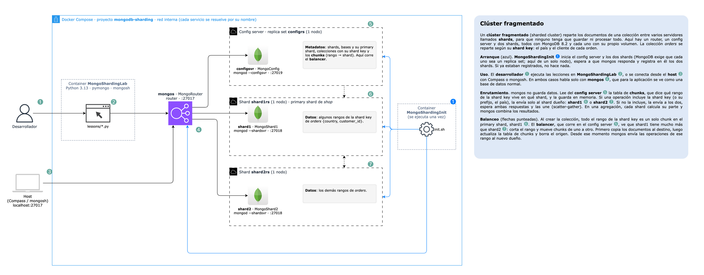

# MongoDB Sharded Cluster

Proyecto para entender cómo funciona un **clúster fragmentado (sharding) de MongoDB**: un router `mongos`, un
config server y dos shards que se reparten una sola colección (`orders`). Incluye una aplicación en Python
(`pymongo`) que escribe, lee, consulta y agrega datos, y muestra a qué shard llega cada operación.



> Diagrama editable: [`docs/architecture.drawio`](docs/architecture.drawio).

## 1. Conceptos de MongoDB

### ¿Qué es MongoDB?

MongoDB es una base de datos **NoSQL orientada a documentos**. En lugar de tablas con filas y columnas, guarda
**documentos** parecidos a JSON, que pueden tener subdocumentos y arrays. Dos documentos de la misma colección
pueden tener campos distintos (esquema flexible).

| Concepto | Qué es | En este proyecto |
| --- | --- | --- |
| **Clúster** | Conjunto de procesos MongoDB que trabajan como una sola base de datos. | Router + config server + 2 shards |
| **Nodo** | Un proceso MongoDB (`mongod` o `mongos`) que forma parte del clúster, normalmente en su propio servidor. Aquí, cada nodo es un contenedor. | `mongos`, `configsvr`, `shard1`, `shard2` |
| **Shard** | Un servidor (o grupo de servidores) que guarda **una parte** de los datos. | `shard1rs`, `shard2rs` |
| **Database** | Contenedor lógico de colecciones. | `shop` |
| **Collection** | Grupo de documentos, equivalente a una tabla. Puede estar fragmentada (repartida entre shards) o no. | `orders` (fragmentada) |
| **Document** | Un registro en formato BSON (JSON binario), de hasta 16 MB. Todo documento tiene un `_id` único. | Una orden |
| **Field** | Un par nombre-valor dentro del documento. | `country`, `total`, `items` |
| **Índice** | Estructura ordenada (B-tree) que evita recorrer toda la colección en una búsqueda. | La shard key tiene su índice |

Un documento de este proyecto:

```javascript
{
  _id: ObjectId("6ac9d61e17c80b40187095ff"),
  order_number: 1520,
  customer_id: "C00731",          // ┐ shard key: { country: 1, customer_id: 1 }
  country: "Colombia",            // ┘
  city: "Medellín",
  status: "delivered",
  items: [ { product: "Portátil", category: "Electrónica", quantity: 1, price: 912.4 } ],
  total: 912.4,
  created_at: ISODate("2026-05-14T10:21:00Z")
}
```

### Programas de MongoDB

| Programa | Qué hace | Aquí |
| --- | --- | --- |
| **`mongod`** | El **servidor de base de datos**: guarda datos en disco, ejecuta consultas y mantiene índices. Con `--shardsvr` actúa como shard; con `--configsvr`, como config server. | `MongoShard1`, `MongoShard2`, `MongoConfig` |
| **`mongos`** | El **router**: recibe las operaciones de la aplicación, decide a qué shard(s) enviarlas y une las respuestas. No guarda datos. | `MongoRouter` |
| **`mongosh`** | El **shell interactivo** de MongoDB, en JavaScript: `db.orders.find()`, `sh.status()`. | En `MongoShardingLab` |
| **Driver (`pymongo`)** | Biblioteca con la que la aplicación habla con MongoDB. Se conecta a `mongos` como si fuera una base normal. | Las lecciones |
| `mongodump` / `mongorestore` / `mongostat` / `mongotop` | Respaldo, restauración y monitoreo. | En `MongoShardingLab` |

### Cómo funciona la base de datos por dentro

- **WiredTiger** es el motor de almacenamiento de cada `mongod`:
  - Bloquea a nivel de documento.
  - Mantiene una caché en memoria.
  - Comprime los datos en disco.
- **Journal**: cada escritura se anota primero en un registro (*journal*) y luego, cada ~60 s, se consolida en
  los archivos de datos (*checkpoint*). Si el proceso se cae, no pierde lo confirmado.
- **Índices**: sin índice, una consulta revisa todos los documentos (`COLLSCAN`); con índice, solo las entradas que
  coinciden (`IXSCAN`). La shard key siempre tiene un índice.

## 2. Sharding

Cuando una colección crece más de lo que un servidor puede guardar o procesar, se **fragmenta**: sus documentos
se reparten entre varios shards, y cada uno guarda y atiende solo una parte.

```text
                 aplicación (pymongo)
                         │
                         ▼
                      mongos ◄──── metadatos ──── config server
                     /       \                    (qué rango vive en qué shard)
                    ▼         ▼
                 shard1     shard2
              (rangos A)  (rangos B)
```

| Pieza | Qué hace |
| --- | --- |
| **Shard key** | Campo o campos que deciden en qué shard vive cada documento. Aquí `{country: 1, customer_id: 1}`. Todos los documentos deben tenerla. |
| **Chunk (rango)** | Un tramo continuo de valores de la shard key, por ejemplo de `{Chile, C01317}` a `{Colombia, MinKey}`. Cada chunk pertenece a un solo shard. |
| **Config server** | Guarda los metadatos del clúster en la base `config`: los shards, las colecciones fragmentadas y la tabla de chunks. Ahí corre el **balancer**. |
| **mongos** | Guarda en memoria la tabla de chunks y **enruta** cada operación. Para la aplicación es una base de datos normal. |
| **Primary shard** | Shard donde vive todo lo que **no** está fragmentado en una base. Aquí `shard1rs` para `shop`. |
| **Balancer** | Si un shard tiene bastante más datos que otro (unas 3 veces el tamaño de chunk), corta rangos y los mueve hasta equilibrar. |

### Enrutamiento: dirigida vs scatter-gather

- **Consulta dirigida** (`SINGLE_SHARD` en `explain`): el filtro incluye la shard key, o su **prefijo** (`country`).
  mongos sabe qué shard tiene esos datos y solo le pregunta a ese. Así es como el sistema escala.
- **Scatter-gather** (`SHARD_MERGE`): el filtro no incluye la shard key (por ejemplo, `status`). mongos pregunta a
  **todos** los shards en paralelo y une las respuestas. Funciona, pero cuesta más a medida que hay más shards.
- **Agregaciones**: mongos divide el pipeline. Cada shard calcula su parte (`$match`, un `$group` parcial) y luego
  se combinan los resultados parciales.

### Elegir la shard key

Es la decisión más importante de un clúster fragmentado. Una buena shard key:

- tiene **muchos valores distintos** (alta cardinalidad), para poder repartir en muchos chunks;
- **no concentra** los documentos en pocos valores;
- **no crece siempre en el mismo sentido** (como una fecha o un contador), porque todas las inserciones caerían en
  el último chunk y en un solo shard (*hot shard*);
- aparece en **las consultas más frecuentes**, para que sean dirigidas.

| Estrategia | Ejemplo | Ventaja | Desventaja |
| --- | --- | --- | --- |
| **Por rango** (la de este proyecto) | `{country: 1, customer_id: 1}` | Las consultas por país o cliente van a un shard; los datos de un país quedan juntos | Con una clave creciente, todo cae en el último chunk |
| **Hashed** | `{customer_id: "hashed"}` | Reparto uniforme, incluso con claves crecientes | Las consultas por rango van a todos los shards |

> **Nota**: en un clúster real, cada shard y el config server son grupos de 3 servidores con la misma copia de los
> datos, para no perderlos si uno falla. MongoDB exige que lo sean (*replica set*), así que aquí cada uno es un
> grupo de **un solo nodo**: cumple el requisito sin agregar piezas que no son de sharding.

## 3. Cómo está armado el proyecto

| Contenedor | Proceso | Puerto interno | Puerto en el host | Rol |
| --- | --- | --- | --- | --- |
| `MongoRouter` (`mongos`) | `mongos --configdb configrs/configsvr:27019` | 27017 | 27017 | Router |
| `MongoConfig` (`configsvr`) | `mongod --configsvr --replSet configrs` | 27019 | 27030 | Config server: metadatos y balancer |
| `MongoShard1` (`shard1`) | `mongod --shardsvr --replSet shard1rs` | 27018 | 27031 | Shard 1 (primary shard de `shop`) |
| `MongoShard2` (`shard2`) | `mongod --shardsvr --replSet shard2rs` | 27018 | 27032 | Shard 2 |
| `MongoShardingInit` | `init.sh` | — | — | Se ejecuta una vez: inicia config server y shards, y los registra en mongos |
| `MongoShardingLab` | Python 3.13 · pymongo · mongosh | — | — | Donde se ejecutan las lecciones |

**Arranque:**

1. Se inician el config server, los dos shards y `mongos`.
2. `MongoShardingInit` inicia el config server y cada shard, espera a que `mongos` responda y registra los dos
   shards con `sh.addShard()`. También fija un tamaño de chunk de 1 MB (el normal es 128 MB) para que el balancer
   actúe con pocos datos.
3. Cada `mongod` guarda sus datos en un volumen propio.

La aplicación solo conoce `mongos`: `mongodb://mongos:27017` dentro de Docker, `mongodb://localhost:27017` desde el host.

```text
.devcontainer.json            # Dev Container de VS Code
.docker/
  Dockerfile                  # img-base (Python + mongosh) -> img-lab
  docker-compose.yml          # Contenedor MongoShardingLab
  sharded-cluster.yml         # mongos, config server, 2 shards y el job de inicialización
  sharded-cluster/init.sh     # rs.initiate() de cada pieza + sh.addShard()
  entrypoint.sh               # Instala requirements y espera los 2 shards
.envs/mongo.env               # MONGO_URI y MONGO_DB
docs/architecture.drawio      # Diagrama
src/lab/                      # Cliente, funciones para imprimir y para leer el enrutamiento
lessons/                      # Lecciones 00-05
```

## 4. Puesta en marcha

**Con VS Code**: `Dev Containers: Reopen in Container`.

**Con la terminal**:

```bash
cd .docker
docker compose -f docker-compose.yml -f sharded-cluster.yml up -d --build
docker exec MongoShardingLab .docker/entrypoint.sh       # solo la primera vez
docker exec -it MongoShardingLab bash                    # entrar al contenedor
```

Dentro del contenedor (`/app`):

```bash
python lessons/00_seed.py      # siempre primero (tarda ~15 s esperando al balancer)
python lessons/01_crud.py      # y así con las demás, en orden
mongosh "$MONGO_URI"           # shell interactivo
```

### Abrir el clúster en MongoDB Compass

En Compass crea una conexión por cada pieza (**New Connection** → pega la URI → **Save & Connect**):

| Conexión | URI | Qué ves |
| --- | --- | --- |
| **mongos** (la base completa) | `mongodb://localhost:27017` | `shop.orders` con sus 20.000 órdenes, como la ve la aplicación |
| **shard1** | `mongodb://localhost:27031/?directConnection=true` | Solo la parte de `orders` que vive en shard1 |
| **shard2** | `mongodb://localhost:27032/?directConnection=true` | Solo la parte de `orders` que vive en shard2 |
| **config server** | `mongodb://localhost:27030/?directConnection=true` | La base `config`: `shards`, `collections`, `chunks` (la tabla de rangos) |

- **mongos no necesita `directConnection`**: es un único router y responde con su propio nombre.
- **Los shards y el config server sí lo necesitan**: sin él, Compass le pregunta al nodo por su replica set,
  recibe el nombre interno de Docker (`shard1:27018`), que tu equipo no conoce, y la conexión falla.

Qué puedes comprobar:

- **El reparto**: la suma de `orders` en shard1 y shard2 es igual a lo que muestra mongos.
- **El enrutamiento**: en shard2 solo aparecen los países de sus chunks (en la conexión al config server, colección
  `chunks`, ves qué rango tiene cada shard).
- **La tabla de chunks cambia en vivo**: ejecuta `python lessons/05_balancer.py` y refresca `config.chunks`; verás
  el rango de Colombia en su nuevo shard.

> **Documentos huérfanos.** Justo después de una migración (en el seed o en la lección 05), el shard de origen todavía
> conserva una copia de los documentos que movió: son *huérfanos*. mongos los ignora, así que la aplicación nunca los
> ve, pero en una conexión directa al shard sí aparecen y los conteos no cuadran. El shard los borra pasado
> `orphanCleanupDelaySecs`, que aquí está en **60 s** (por defecto es 1 hora). Los rangos pendientes de borrar
> están en la colección `config.rangeDeletions` de cada shard.

> **No escribas directo en un shard.** Las escrituras deben pasar por mongos. Si insertas en un shard un documento
> cuyo rango no le pertenece, mongos nunca lo encontrará. Usa las conexiones directas solo para mirar.

Borrar todo, incluidos los datos:

```bash
cd .docker
docker compose -f docker-compose.yml -f sharded-cluster.yml down -v
```

## 5. Lecciones

| Lección | Qué hace | Qué observar |
| --- | --- | --- |
| `00_seed.py` | `enableSharding` crea la base `shop`; `shardCollection` fragmenta `orders` por `{country, customer_id}`; inserta 20.000 órdenes y espera al balancer. | Justo después de insertar, **todo** está en `shard1rs`, porque la colección empieza con un solo chunk. Segundos después, el balancer ya movió una parte a `shard2rs`. |
| `01_crud.py` | **Create**, **Read**, **Update** (incluido cambiar el país de una orden, lo que la mueve de rango) y **Delete** a través de `mongos`. | Leer con la shard key va a un shard; leer por `order_number` va a los dos. El código es el mismo que con una base sin fragmentar. |
| `02_queries.py` | Siete filtros distintos con su número de resultados y los shards consultados; también `$elemMatch`, `$expr`, orden, límite y `distinct`. | Cliente, país, `$in` y rangos de país son `SINGLE_SHARD`. `status`, ciudad o `customer_id` solo (sin `country`) son `SHARD_MERGE`. |
| `03_aggregations.py` | Ventas por país, unidades por categoría (`$unwind`), órdenes por mes y estado, top clientes de un país, y el `explain` de cómo mongos divide un pipeline. | `shardsPart` es lo que hace cada shard (un `$group` parcial); `mergerPart` es cómo se combinan (`$mergeCursors` + `$group`). |
| `04_metadata.py` | Recorre la base `config`: shards, primary shard, colecciones fragmentadas, **tabla de chunks** y datos por shard. | Cada chunk es un rango `desde` → `hasta` de la shard key con su shard dueño. |
| `05_balancer.py` | Estado del balancer; corta (`split`) y mueve (`moveRange`) todos los chunks de Colombia a un mismo shard. | Antes, la consulta por Colombia puede ir a un shard o a dos; después, siempre va al shard destino, sin cambios en la aplicación. |

Para volver al estado inicial: `python lessons/00_seed.py`.

## 6. Comandos útiles

En `mongosh "$MONGO_URI"`:

```javascript
sh.status()                                   // shards, bases, colecciones fragmentadas y chunks
use shop
db.orders.getShardDistribution()              // documentos y tamaño por shard
db.orders.find({ country: "Perú" }).explain() // winningPlan.stage: SINGLE_SHARD o SHARD_MERGE
db.getSiblingDB("config").chunks.find({}, { min: 1, max: 1, shard: 1 })
sh.getBalancerState()                         // ¿está activo el balancer?
sh.stopBalancer(); sh.startBalancer()
db.adminCommand({ listShards: 1 })
```

Experimento desde el host:

```bash
# Apagar un shard: las consultas dirigidas al otro shard siguen funcionando; las que necesitan el apagado fallan
docker stop MongoShard2
docker exec MongoShardingLab bash -c 'mongosh "$MONGO_URI/shop" --quiet --eval "db.orders.countDocuments({ status: \"paid\" })"'
#   -> MongoServerError: Could not find host ... for set shard2rs   (scatter-gather necesita los dos shards)
docker exec MongoShardingLab bash -c 'mongosh "$MONGO_URI/shop" --quiet --eval "db.orders.countDocuments({ country: \"Perú\" })"'
#   -> 2685   (si Perú vive en shard1rs; revisa con la lección 04 qué países tiene cada shard)
docker start MongoShard2
```

## Notas

- **Sin autenticación**: el proyecto es solo para aprendizaje local. `mongos` se publica en `localhost:27017`, y
  el config server y los shards en 27030-27032 únicamente para inspeccionarlos con Compass. En producción solo se
  expone mongos, y se usan autenticación entre nodos (`keyFile` o x.509), usuarios con roles y TLS.
- Cada `mongod` limita su caché a 256 MB para no consumir demasiada memoria.
